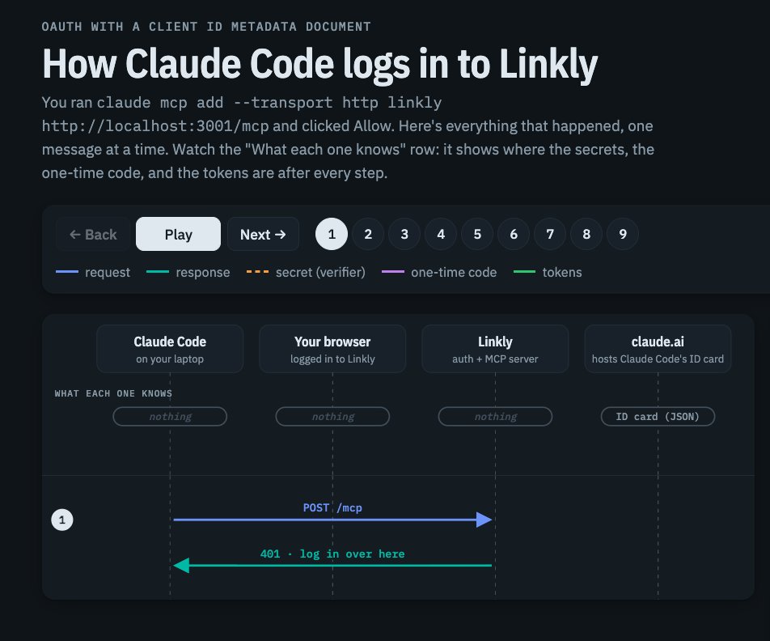

# Linkly architecture

Read this first. Linkly is a link shortener, but the product is only the vehicle: the point is to show one way to structure an MCP server so it stays small, safe, and in sync with the rest of the product. Each section below states a principle and links to the code that implements it.

- [Vertical slices and the adapter rule](#vertical-slices-and-the-adapter-rule)
- [The principles](#the-principles)
- [MCP vs API vs CLI](#mcp-vs-api-vs-cli)
- [If the MCP tools match the API, why have MCP?](#if-the-mcp-tools-match-the-api-why-have-mcp)
- [Why the MCP server is stateless](#why-the-mcp-server-is-stateless)
- [How OAuth works here](#how-oauth-works-here)
- [Testing strategy](#testing-strategy)

## Vertical slices and the adapter rule

**Watch it first:** [Linkly's Four Ways In](https://claude.ai/artifact/QAS55rqPuKkD1ccAGc6M31) is an animated walkthrough of this section. It sends one "create a link" request through the dashboard, REST, MCP, and the CLI, and shows each one become a `Principal`, pass through a thin adapter, and reach the same `createLink` in `service.ts`. Switch it to "Slug taken" to see one `DomainError` come back as a toast, a `409`, an MCP tool error, and CLI exit code 6.

Code is organized **by feature, not by layer**. Each slice in `src/` owns everything about its feature: Zod schemas, business logic, Wasp operations, REST handlers, MCP tools, OpenAPI paths, UI, tests, and its own Wasp Spec file.

```
                ┌──────────────┐
  Dashboard ───▶│ operations.ts│──┐
                └──────────────┘  │
                ┌──────────────┐  │    ┌────────────┐     ┌────────┐
  REST API ────▶│   rest.ts    │──┼───▶│ service.ts │────▶│ Prisma │
                └──────────────┘  │    └────────────┘     └────────┘
                ┌──────────────┐  │
  MCP ─────────▶│    mcp.ts    │──┘
                └──────────────┘

  CLI (user's machine) ── HTTP + PAT ──▶ REST API
```

The rules:

1. **All business logic and authorization live in `service.ts`** (e.g. [`src/links/service.ts`](../src/links/service.ts)). Adapters only parse input, build a `Principal`, call the service, and format output. Compare [`operations.ts`](../src/links/operations.ts), [`rest.ts`](../src/links/rest.ts), and [`mcp.ts`](../src/links/mcp.ts) for the same five functions.
2. **Shapes live in `schemas.ts`** ([`src/links/schemas.ts`](../src/links/schemas.ts)). The same Zod schemas validate dashboard forms, REST bodies, and MCP tool input, and generate the OpenAPI document.
3. **Services never import Wasp, Express, or the MCP SDK.** They take `(principal, input, deps)` and throw [`DomainError`](../src/shared/errors.ts)s. That's what lets them be unit tested against a real database without a server, and what makes the adapters thin.
4. **Every caller is a [`Principal`](../src/shared/principal.ts)**: a user ID, a set of scopes, where the call came from (`session`, `pat`, `oauth`), and whether destructive actions need confirmation. Dashboard sessions get every scope, so "the dashboard can do it" and "a fully-scoped token can do it" are the same statement.
5. **The Wasp Spec follows the slices.** Each slice declares its pages, operations, and APIs in its own `*.wasp.ts` (e.g. [`src/links/links.wasp.ts`](../src/links/links.wasp.ts)); [`main.wasp.ts`](../main.wasp.ts) only joins them.

The **CLI** ([`cli/`](../cli/)) is the one surface that doesn't call `service.ts`: it runs on the user's machine and talks to the REST API like any other client, using types generated from the OpenAPI document.

## The principles

### The MCP server can do everything the dashboard can

Every feature is a service function; the dashboard and MCP are adapters over the same functions with the same scope checks. [`src/mcp/parity.test.ts`](../src/mcp/parity.test.ts) makes it executable: it reads every Wasp operation from the `*.wasp.ts` files and requires each one to map to an MCP tool, or to state why it's dashboard-only (for example, "consent has to come from the human, not from the app asking for access"). Adding an operation or a tool without updating the map fails the test.

### Destructive actions are safe, via deep links

`delete_link` either deletes or returns a **confirmation URL**, based on the connection's "Require confirmation" setting (chosen on the consent screen, default on). The decision lives in exactly one function, [`requestDeletion`](../src/links/service.ts), used by MCP and REST alike:

| Caller | Result |
|---|---|
| Dashboard session | Deleted (the UI's own dialog is the confirmation) |
| Personal access token (REST, MCP, CLI) | Deleted (the CLI requires `--yes`) |
| OAuth connection with confirmation on | `confirmation_required` + `confirmUrl` (REST: `202`). MCP clients with URL-mode elicitation open the page themselves and get `deleted` or `not_deleted` |
| OAuth connection with confirmation off | Deleted |

A confirmation creates a [`PendingAction`](../src/deeplinks/pendingActions.ts) (15-minute expiry). The user opens [`/confirm/:actionId`](../src/deeplinks/ui/ConfirmActionPage.tsx), sees the link and which app asked, and confirms. Only the same user, in a dashboard session, before expiry, once. The link works in every MCP client, because it's just a URL in a tool result. Clients that support URL-mode elicitation open the same page themselves ([details below](#why-the-mcp-server-is-stateless)).

### No codemode, no lazy loading

Tools are plain and fully described: no `execute_code` tool and no "list tools, then load tools" meta-tool. Context bloat is a property of how tools are exposed, not of MCP itself: Linkly keeps tool definitions small and precise instead. [`src/mcp/descriptions.test.ts`](../src/mcp/descriptions.test.ts) lints them: a title, a description of at least 60 characters that mentions related tools, `.describe()` on every input field, enum values explained, and correct `readOnlyHint` / `destructiveHint` annotations.

### Search docs as a tool

[`search_docs`](../src/docs/mcp.ts) and `read_doc` are always available, and the server's instructions tell agents to use them when unsure how a Linkly concept works. The docs are data ([`src/docs/content.ts`](../src/docs/content.ts)), searched with simple, explainable scoring ([`searchDocs`](../src/docs/service.ts): title ×3, tag ×2, body term frequency). Every doc is also an MCP resource at `docs://linkly/<slug>` ([`docsResources`](../src/docs/mcp.ts)) for clients that surface resources.

### Deep links into the product

Every entity returned by any surface carries a `dashboardUrl`, built by the pure builders in [`src/deeplinks/urls.ts`](../src/deeplinks/urls.ts); the [`get_dashboard_url`](../src/deeplinks/mcp.ts) tool exposes them directly ("Use this when the user wants to see, visualize, or manually edit something in Linkly"). The pages honor every parameter the builders produce: `/links/:id?tab=stats&range=30d&groupBy=referrer` opens that exact chart, `/links/new?destinationUrl=...` opens a prefilled form. [`src/deeplinks/urls.test.ts`](../src/deeplinks/urls.test.ts) checks that every builder targets a route that exists.

### Toolsets and customization

Scopes and toolsets are defined once in [`src/shared/scopes.ts`](../src/shared/scopes.ts). The user picks scopes on the [consent screen](../src/oauth/ui/ConsentPage.tsx), one checkbox each, grouped by toolset ([`ScopeChecklist`](../src/oauth/ui/ScopeChecklist.tsx)), so read and write are separate choices. Ticking write also ticks read, because write access can already read (`update_link` returns the link). The grant stores the chosen scopes and the ones the app asked for; editing it later on [Connections](../src/oauth/ui/ConnectionsPage.tsx) can narrow or restore scopes, never go beyond the request. The [registry](../src/mcp/registry.ts) (`toolsFor`) always includes the core tools, requires each other tool's scope, and lets an optional `?toolsets=` URL parameter narrow (never widen) the list. Because principals are built from the grant on every request, edits apply to existing tokens immediately.

### OAuth from any client

Any MCP client can connect with no registration step and **no client allowlist**. The consent screen is the security boundary: it shows the client's name and, prominently, the host of its `client_id`, with a note that Linkly hasn't verified the app. The mechanism is in [How OAuth works here](#how-oauth-works-here).

### The API spec is the baseline

The versioned REST API at `/api/v1` ([`src/links/rest.ts`](../src/links/rest.ts), [`src/analytics/rest.ts`](../src/analytics/rest.ts), ...) is described by an OpenAPI 3.1 document generated from the same Zod schemas ([`src/openapi/document.ts`](../src/openapi/document.ts)) and usable with personal access tokens ([`src/tokens/`](../src/tokens/)). It's the "just ship your API" baseline every other surface could be built from, and the CLI literally is.

### Same tools, every surface

This is the [adapter rule](#vertical-slices-and-the-adapter-rule) applied to the CLI too: the CLI calls REST, which calls the same services. [`tests/cliParity.test.ts`](../tests/cliParity.test.ts) requires every MCP tool to have a CLI command, or a stated reason why not, so the dashboard ⇄ MCP ⇄ CLI chain stays complete.

### Every surface says what's destructive

MCP tools carry `destructiveHint`, every OpenAPI operation declares `x-destructive`, and destructive CLI commands require `--yes`. [`tests/destructiveFlags.test.ts`](../tests/destructiveFlags.test.ts) checks that all three agree.

## MCP vs API vs CLI

MCP, REST APIs, and CLIs are all ways for an agent to call the same tools. Convert one into another and the tools don't change; what changes is the **execution environment** and its dependencies. Linkly has all three over one service layer, so you can compare them directly.

| | Use it when | What it needs | What it gives you |
|---|---|---|---|
| **MCP** (`/mcp`) | The caller is an agent inside a chat client (desktop, web, or mobile) | Just the URL; OAuth happens in the browser | Discovery, OAuth from any client, self-describing tools, annotations clients act on, docs as resources |
| **REST** (`/api/v1`) | Raw data access, scripts, integrations, other services | An HTTP client and a token | The baseline: stable, versioned, described by OpenAPI |
| **CLI** (`linkly`) | A human or an agent with a shell | A shell, Node, a token | Composes with pipes and `jq`, easy to debug, runs locally |

The CLI follows rules that make it safe for agents, each because agents get stuck without it ([`cli/src/program.ts`](../cli/src/program.ts)):

1. **Never prompt.** An agent can't answer an interactive prompt; a command that waits for input just hangs. Missing input is a usage error (exit 2) that names the flag to add. The tests run every command with stdin open and unwritten, so a command that tried to read it would time out.
2. **Destructive commands need `--yes`.** Without it: exit 2 and `Refusing to delete without --yes. Re-run: linkly links delete <id> --yes`. The agent has to decide explicitly.
3. **JSON when piped.** `--json`, or any non-TTY stdout, prints exactly the REST response body, so agents parse the same shapes the API documents.
4. **Errors on stderr, meaningful exit codes**: 0 ok, 1 unexpected, 2 usage, 3 unauthorized, 4 forbidden, 5 not found, 6 conflict. Agents can branch without parsing prose.
5. **Good `--help`** with examples on every command, because `--help` is how an agent learns a CLI.
6. **No hidden state** beyond the config file (mode 0600).

## If the MCP tools match the API, why have MCP?

You'll notice Linkly's MCP tools map one to one to REST endpoints. That's deliberate: the tools are the same, and MCP's value is in **how an agent connects and uses them**, not in extra abilities.

1. **No shell needed.** MCP is the standard way chat and mobile clients (Claude, ChatGPT) connect to apps. Their other options are off by default, work in only one client, or make the user handle tokens: a code sandbox with network access, an agent clicking through your UI, or ChatGPT's GPT Actions calling an OpenAPI spec ([`src/mcp/handler.ts`](../src/mcp/handler.ts)).
2. **Setup is pasting one URL.** The client discovers the login from a `401`, needs no registration, and the user clicks Allow ([How OAuth works here](#how-oauth-works-here)). That replaces "create a token and explain the API to your agent".
3. **Tools describe themselves.** On connect, the client gets every tool's name, description, input and output schema, plus the server's instructions, with nothing to configure ([`src/mcp/defineTool.ts`](../src/mcp/defineTool.ts), [`src/mcp/server.ts`](../src/mcp/server.ts)).
4. **Safety hints clients understand.** Clients act on `readOnlyHint` and `destructiveHint`: auto-running reads, asking before deletes. OpenAPI has no standard equivalent, which is why Linkly's `x-destructive` is a custom extension that most tools ignore.
5. **Features that only exist on MCP here:** the tool list shrinks to what the user granted, clients can open the confirm page themselves (URL-mode elicitation), and docs are exposed as resources the client can browse and attach. REST shares the rest: the same consent screen and scopes, the confirmation link (as a `202`), and the same error text written for agents (`Link "abc" not found. Use list_links to find valid IDs or slugs.`).

The tradeoff: for developers and coding agents with a shell, REST plus the CLI is enough; most apps could stop there. MCP pays off when **non-developers** use the product through an AI assistant in a chat app.

## Why the MCP server is stateless

[`src/mcp/handler.ts`](../src/mcp/handler.ts) passes every request to one `createMcpHandler` from the MCP SDK (v2). It builds a fresh `McpServer` for the request's principal and discards it once the response is sent. Any instance can serve any request: it scales horizontally with no session affinity and no in-memory state to explain.

**One endpoint serves both protocol eras.** Clients on 2025-11-25 or earlier connect with `initialize`, and each of their requests is answered statelessly. Clients on 2026-07-28 skip the handshake: that revision makes the protocol itself stateless, and every request carries the client's capabilities.

**That's what makes elicitation possible here.** Under 2025-11-25, a server asks the user something by sending the client a request mid-call and waiting for the reply on the same connection, which a stateless server can't do. Under 2026-07-28, the server returns an `input_required` result instead, and the client retries the call with the answer. Linkly uses this for one thing: confirming deletions with URL-mode elicitation ([`src/mcp/confirmations.ts`](../src/mcp/confirmations.ts)).

- **The first call:** `delete_link` creates the pending deletion as before. If the request declares `elicitation.url`, the server returns the `/confirm/:actionId` page as a URL-mode request, with a signed `requestState`. The client shows the URL and opens it if the user agrees.
- **The retry:** "accept" only means the page opened, so the server checks the pending deletion. Clients retry as soon as the page opens, so the server polls for up to 20 seconds, then returns `input_required` with only the state, and the client retries without asking the user again. The answer is `deleted`, or `not_deleted` if the user declined, cancelled on the page, or let it expire. After about 2.5 minutes the server stops waiting and returns the link.
- **The signed state:** an HMAC with `MCP_REQUEST_STATE_KEY`, bound to the user and the grant, expiring with the pending deletion. The SDK rejects tampered, expired, or another grant's state before the tool runs. The pending deletion itself stays single-use.
- **Every other client gets `confirmUrl`** in the tool result: 2025-era clients (a stateless server never sees their capabilities), clients without URL mode, and REST. As of October 2026 that includes most chat apps; the Claude Code CLI is the main client that opens the page itself.

Either way, the user confirms on Linkly's own page, in their logged-in session. Elicitation changes how the link reaches the user, not who can confirm.

**Push notifications** (telling the client that the tool list changed after a grant is edited) would use 2026-07-28's `subscriptions/listen` stream. Linkly doesn't need them: every request rebuilds the tool list from the grant.

## How OAuth works here

Linkly is both the resource server (`/mcp`, `/api/v1`) and the authorization server.



This section is the short, code-first version. New to OAuth for agents? Watch [How Claude Code Connects](https://claude.ai/artifact/RMZAmj4Am7cQNUAkW3bMxX), then read [OAuth for agents, explained](OAUTH-FOR-AGENTS.md) for the concepts and common questions.

1. **Discovery.** A request without a token gets `401` and `WWW-Authenticate: Bearer resource_metadata=".../.well-known/oauth-protected-resource/mcp"` ([`withBearer`](../src/shared/http.ts)). That document ([`metadata.ts`](../src/oauth/metadata.ts)) names the authorization server, whose metadata lists the endpoints.
2. **Client identity (CIMD).** The client's `client_id` is a URL. [`resolveClient`](../src/oauth/cimd.ts) fetches it with SSRF guards ([`ssrf.ts`](../src/oauth/ssrf.ts): every resolved address is checked at connect time against private, loopback, link-local, and reserved ranges; 5s timeout; 64 KB limit; no redirects), validates that the document's `client_id` matches its URL, and caches it for 24 hours. `http://localhost` client IDs are allowed only in development and test.
3. **Consent.** [`/oauth/authorize`](../src/oauth/ui/ConsentPage.tsx) is a Wasp page (so it lives on the frontend origin and reuses Wasp's login). A bad `client_id` or `redirect_uri` shows an error and **never redirects**; other problems redirect back with `error=`. Redirect URIs must match exactly, except loopback redirects, which match on any port (RFC 8252).
4. **Code for tokens.** [`exchangeToken`](../src/oauth/token.ts) verifies the single-use, 60-second code and the PKCE S256 verifier, creates or updates one grant per user and client, and issues a 1-hour access token (audience-bound to `/mcp` or `/api/v1`) and a 30-day refresh token. Refresh tokens rotate on every use; reusing one, or reusing a code, revokes the whole grant.
5. **Every request.** [`authenticateBearer`](../src/shared/bearer.ts) hashes the token (only SHA-256 hashes are stored), checks expiry, revocation, and audience, and builds the principal's permissions **from the grant** (see [Toolsets and customization](#toolsets-and-customization)).

## Testing strategy

Wasp runs client tests only, so tests come in three kinds:

- **Server unit tests** (`npm test`, [`vitest.config.ts`](../vitest.config.ts)): services, OAuth logic, the MCP registry and server (a real SDK client calling the handler in process, over both protocol eras), parity and lint tests, against a real Postgres test database. This works because services never import Wasp.
- **Live-server tests** (`npm run test:e2e`, [`playwright.config.ts`](../playwright.config.ts)): Playwright starts `wasp start` on the test database and runs browser flows, REST, MCP SDK clients over Streamable HTTP (v1 as a 2025-era client, v2 for 2026-07-28 and URL-mode elicitation), the complete OAuth flow headless (a local [test client](../e2e/fixtures/testClient.ts) serves its CIMD document and catches the redirect), and the CLI as a subprocess.
- **Manual checks** that can't be automated, and their results, are listed in [`NOTES.md`](../NOTES.md#manual-checks-still-to-do).
