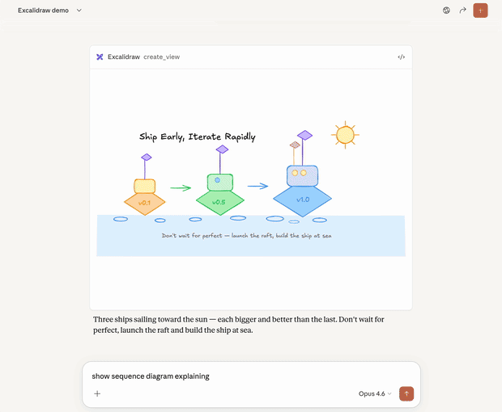
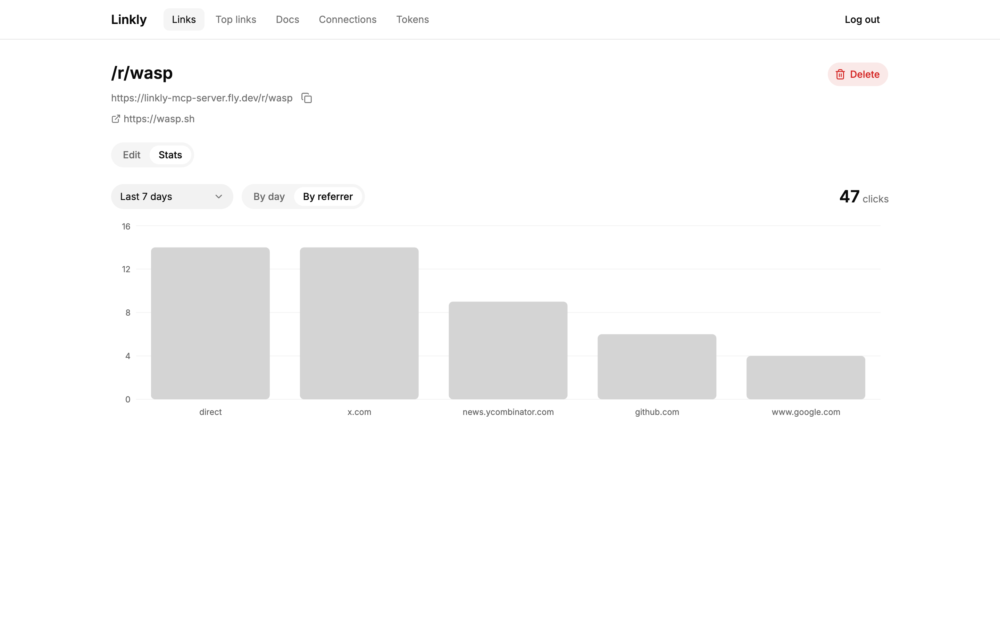
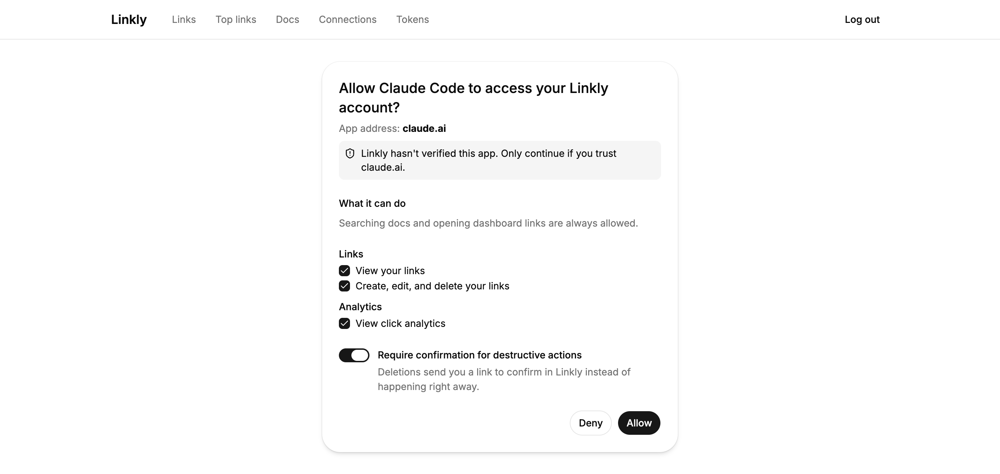
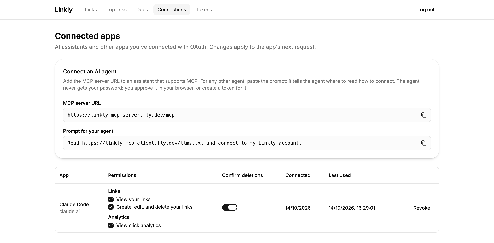
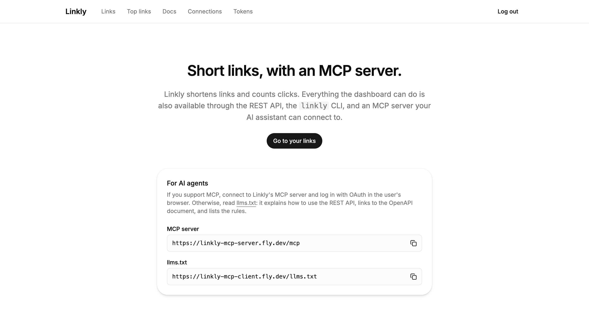

# Working title: How to make your app usable by AI agents (MCPs, APIS, CLIs)

<!-- IDEA: add a "copy prompt" that gives this whole article along with a "summarize part 1 (the why)" prompt and a "extract part 2 (the how) into an implementation spec" prompt -->

## Agents are your new users

We're at the end of 2026, and for the first time, [more than half of internet traffic isn't human](https://blog.cloudflare.com/agentic-web/), while daily requests from AI agents grew by more than 1,700% in the past year.

These are crazy statistics.

But if you're someone who works close to this tech, you don't even have to see the numbers to sense the shift. As a web developer, I, for one, have felt increasingly left behind when considering how to build apps in this era. I know I should be building agent-facing tools, but which ones... and how?

For example, when MCP servers dropped last year a lot of the [loudest voices derided them](https://x.com/levelsio/status/2031943074151104634?s=20), claiming there was nothing they can do that APIs or CLIs can't already do, or do better.

But I wanted to really understand each tool and come to my own opinions because, in the end, I want agents to get as much value out of my apps as possible. So, I set out to answer these questions, and I outline what I landed on in this article below.

To get there, I did a lot of reading and exploring, and built an open-sourced link shortener, called Linkly, as an example app. Linky has a dashboard, an MCP server, a REST API, and a CLI. Unless I say otherwise, all the examples in this post come from it, and the repo is [here](https://github.com/vincanger/linkly-api-mcp-cli).

This post has two parts. In the first, I explain why I think MCP should get most of your attention, and where an API and a CLI still beat it. In the second, I show how Linkly builds all three on top of the same code, so you can do the same in your app. And if you just want the TL;DR, skip to [what I'd build](#so-heres-what-id-build).

## Part 1: What to build

### What MCP gives you that an API can't

MCP is a standardized way for agents to connect to apps, tools, and data. It was designed for exactly this, and it's maturing fast: the [2026-07-28 revision](https://modelcontextprotocol.io/specification/2026-07-28) made the protocol stateless, and clients are tackling its context bloat with tool search and [code mode](https://www.anthropic.com/engineering/code-execution-with-mcp) (which were the first real gripes developers had with it, and rightly so), so connecting lots of servers to one agent is no longer the problem it was just a handful of months ago.

But, even more broadly, MCP just gives you and your agent a nicer, more curated experience because it standardizes how things should be done on the server *and* client side. An API (and its OpenAPI document) only describes your server: its endpoints, and their inputs and outputs. Nothing in it says what the client should do. MCP defines the client's behavior, too, e.g. how the desktop app, IDE, or assistant on your phone that sits between the agent and the human user should respond to that data. 

That's the main advantage MCP has over an API or CLI. It may seem small, but it's a compounding advantage when you start to consider all the different types of agents out there, and the future potential of the space.

Here's a simple example from Linkly, animated below. Let's imagine that you have two shortened links in the databse to https://wasp.sh: an old one from last year's launch, and a new one, `/r/wasp`, which is printed on your conference badges. You ask your agent to delete the old wasp.sh link, and it picks the wrong one. A delete can't be undone, so Linkly wants you to confirm it first:

![Two panels. With a flag the agent can set, your API asks for confirm=true, the question goes back to the agent, the agent sets the flag itself, and /r/wasp is deleted without anyone asking you. With MCP, the server asks the client to open your app's confirmation page, which shows "Delete this link? /r/wasp, goes to wasp.sh, requested by Claude Code." You see it's the link on your badges and click Cancel. The answer goes from the page to the server, nothing is deleted, and the agent learns you cancelled.](./assets/delete-confirmation.svg)

If your app asks for confirmation with a flag, like `confirm=true` on an API or `--yes` on a CLI, the question goes back to the agent, and the agent can just set the flag itself. So now your badges point to a 404, and nobody asked you. (And even if you build something more elaborate around your API, a proactive agent could still use computer use to push it through. [Yes, this kind of stuff does still happen](https://x.com/ShaneMac/status/2107486740491669879?s=20).)

With MCP, Linkly answers the `delete_link` call with a new feature called [elicitation](https://modelcontextprotocol.io/specification/2026-07-28/client/elicitation): a request for the client to open a confirmation page on Linkly. The client, not the agent, opens it for you. The page shows the short link, where it goes, and which app asked. You spot `/r/wasp`, click Cancel, and nothing gets deleted. The agent learns you cancelled, so it can go find the right link instead.

<!-- TODO: add the elicitation video here -->

And because your server writes the question, it can show exactly what the user needs to check, and because the answer comes from your own page, where the user is logged in, the agent never even gets the chance to answer in their place. (Part 2 shows the real thing in Claude Code, video included.)

That's one of a few things an MCP client does for you that an API or CLI leaves up to the agent. In Linkly:

- **The client handles the login.** You paste Linkly's MCP URL into your client, approve it in your browser, and the client keeps the token and attaches it to every request on its own, so the model never even sees it.
- **The model only sees the tools it's allowed to use.** Linkly hides the tools whose permission the user didn't grant, so a read-only connection never sees `create_link` and never tries it.
- **Your instructions come along with the tools.** The server hands the client a few sentences about what Linkly is and how its tools fit together, and each tool's description says when to use it, and what follow-up tools it may want to use. Nobody has to paste a prompt anywhere.
- **The server can ask the human.** That's the confirmation from the animation.

And the list of things only MCP can do keeps growing. I didnt build these two features into Linkly, but they're worth knowing about: [MCP Apps]() <!-- TODO: add mcp app link --> put UI, like an interactive chart or a form, right in the chat. Here's the Excalidraw MCP App drawing a diagram inside a Claude chat:

<!-- TODO: convert to mp4 -->


And [MCP Events](https://mixed-news.com/en/chatgpt-mcp-events-webhooks-draft-spec-work-chats/), which ChatGPT shipped on September 29, let your server tell the agent when something changes, so it can act on it automatically without anyone typing a prompt. 

Client support for both of these features is still uneven (as of October 2026), so it's important to consider fallbacks. Only some of them can open Linkly's confirmation page, for example, and not all can show an MCP App (Although the major ones like ChatGPT and Claude can). So each feature benefits from a fallback for the clients that lag behind, and the nice thing is that a link to your app is almost always a good one:

- Linkly can't draw a chart in every chat, so every stats result includes a `dashboardUrl` that opens the same chart in the app.

  

- Clients that can't open the confirmation page get the same page as a link in the tool result, for the agent to pass along.
- And instead of a form in the chat, `get_dashboard_url` can return a link to Linkly's create form, already filled in.

When a client adds support, the better version just starts working for your users.

Needless to say, I'm bullish on the MCP space and think it will blossom into a really cool ecosystem with interesting new workflows for app builders. With that said, there are still times when an API or CLI might be a a better fit for agents than an MCP. It just depends on the type of data coming from your app, along with your user's typical workflows.

### Where an API (and a CLI) still win

None of this means APIs are bad for agents. They're ["probably fine for 90% of applications"](https://x.com/RhysSullivan/status/2070630745891365008): agents call them easily, they're the right tool for raw data exports and bulk jobs, and with a well-written OpenAPI doc, an agent can even turn one into an MCP server for you.

And for some jobs, like bulk updates or exporting raw data, agents are better off writing deterministic tools (e.g. scripts, internal tools, jobs) that call the API directly, rather than going through MCP tools. For example, here are two tasks in Linkly, done both ways:

<!-- TODO: turn this table into an animated SVG, in the style of two-layers.svg and delete-confirmation.svg. -->

| Task (Linkly) | OpenAPI + a script | MCP tools |
|---|---|---|
| **A job you'll rerun:** "Tag every link to example.com as `partner`, and do it again each month" | List, filter, then `PATCH` each match. A script anyone on the team can read, rerun, and schedule. | With code mode, one loop over `update_link`, but it lives in one conversation. Without it, 300 round trips through the model. |
| **Curated:** "How did my launch link do last week?" | One `GET /api/v1/links/{id}/stats` call. | One `get_link_stats` call from any client. Its description tells the model to share the `dashboardUrl`, which opens an interactive chart in Linkly, and to use `get_top_links` to compare links. |

Notice that the API's advantage isn't really volume. Without code mode, every row an MCP tool returns, and every update, passes through the model's context. But clients with [code mode](#what-mcp-gives-you-that-an-api-cant) close that gap: the model writes a loop over your tools (that's the "code"), runs it in the client's sandbox (that's the "mode"), and only the result comes back. For an agent doing a job once, that's just as good as a script.

It's important to note that only a few clients have code mode so far, though. OpenCode turns it on by default, and Codex has it behind a flag. Claude Code and the Claude apps only do the tool search half: they load just the tools the model needs, but every result still passes through the model.

Some apps fix this on the server side instead, with a query tool. PostHog, for example, [created a read-only `executeSql` tool](https://x.com/posthog/status/2109706665033691359), and "Why did signups drop?" went from four separate tool calls to one query. Agents are good at writing SQL, and the database does the heavy lifting instead of the model's context. That only covers reads, though, and it mostly makes sense if your app is all about data (more on that in the [MCP checklist](#the-mcp-server)).

What code mode doesn't change, though, is who's calling. A nightly sync, an internal tool, or another company's integration will be better off using an API. And when a job is worth keeping, you probably want your agent to write a script around it, rather than repeatedly calling your tools from within a chat thread.

<!-- TODO: fact-check the api claim -->
For the curated task, though, MCP brings a lot of advantages. Both surfaces can answer "How did my launch link do last week?" in one call. But the MCP tool works in any client where you've connected Linkly (you can't always connect to APIs in agent desktop apps, for example), and it comes with the know-how about what to do next, like sharing the chart link or comparing links with an additional `get_top_links` tool call.

CLIs work well too, but only for agents with a shell. They're definitely at an advantage when an agent needs to interact with local files on the user's own machine, too. If this is the case, a CLI makes sense. A remote MCP server can't read your disk, so to shorten 500 URLs from a file, the agent has to pass every URL through its context, whereas A CLI reads the file itself:

```bash
# Shorten every URL in a local file
cat urls.txt | xargs -n1 linkly links create

# Export every link to a local file
linkly links list --all --json > links.json
```

The agent only has to write one line, the data goes straight from your disk to the API without passing through the model, and anyone can rerun it later.

### Choosing which tools to expose

To put it simply, an MCP shines in the agent-native world because it tells agents what they *should* do, on both the server and client. Meanwhile, APIs and CLIs tend to focus on what agents *can* do, with emphasis mainly on the server. 

So, in summary, here is the general advice I'd give to builders when deciding which tools they should expose to agents:

**Build a high-quality MCP server and REST API at the same time, on one layer of operations.** Put your server logic in plain functions, and let each surface be a thin adapter over them. Once that layer exists, building any additional surface on top is relatively easy.

**Put most of your care into the MCP server.** That's where agents get the best experience. MCP is a standard built *specifically* for agents, after all.

**Use the API for code that runs on its own.** APIs are still great for raw data exports, bulk writes, and anything that runs without an agent, like a nightly sync or another company's integration. Agents also prefer an API when they're writing a script they'll rerun, and many clients don't support code mode for MCP yet.

**A CLI probably isn't necessary**, unless agents need to read local files when interacting with your app. But it's easy to expose one if you've got a good API as the foundation.

To build this into your app, here's the structure I'd use, and it's what Part 2 below walks through in detail:

1. [Put your logic in operations](#the-foundation-operations-underneath-every-surface), one function per action, so every surface is a thin adapter over the same code.
2. [Expose them through MCP](#the-mcp-server), with task-shaped tools and good descriptions written for the model.
3. [And through REST](#the-rest-api), with an OpenAPI document generated from the same schemas.
4. [Put one OAuth server in front of both](#one-oauth-server-in-front-of-both), and let people choose each permission. Keep personal access tokens for scripts.
5. [Make destructive actions wait for the human](#destructive-actions-wait-for-the-human-on-every-surface), on every surface.
6. [Add a CLI](#a-cli-if-your-users-have-shells), if your users really need it.
7. [Help agents find you](#help-agents-find-you-from-your-domain) from your domain alone.

Each of the sections below goes into detail on one of these steps: how Linkly does it, with the actual code, plus a list of rules I'd follow and the mistakes I'd avoid.

## Part 2: How to build it (a guide you can hand to your agent)

### The foundation: operations underneath every surface

By splitting your app into two layers, every surface you build on top gets the same logic underneath. Your dashboard, the API, your MCP server, and a CLI all call the same operations, so there's no duplicated logic to drift apart between them.

Here are the two layers:

1. **Operations:** your business logic, one function per thing a user can do.
2. **Surfaces:** thin adapters that expose those operations to each kind of caller.

For example, when you click "Create link" in Linkly's dashboard, it calls the exact same [`createLink` function](https://github.com/vincanger/linkly-api-mcp-cli/blob/main/src/links/service.ts#L80-L111) that an agent calls through MCP, or a script calls through the REST API.


Even the CLI doesn't have any server code of its own. It's just a client for the REST API.

Why does that matter? Because everything that actually makes your app *your app* lives in the operation: who's allowed to do what, what counts as valid input, the business rules, and the error messages. Here's `createLink`, simplified:

```ts
export async function createLink(p: Principal, input: LinkInput, { prisma }: Deps): Promise<LinkOut> {
  requireScope(p, "links:write");            // who's allowed
  const data = parseInput(LinkInput, input); // what counts as valid input
  if (data.slug) {
    await assertSlugFree(prisma, data.slug); // the rules: a taken slug throws a "conflict" error
    return toLinkOut(await prisma.link.create({ data: { ...data, userId: p.userId } }));
  }
  // ...otherwise, retry random slugs until one is free
}
```

Every operation in Linkly has this same shape: who's calling (a `Principal`, more on it in the [OAuth section](#one-oauth-server-in-front-of-both)), the input, and its dependencies, like the database. There's no `req`, `res`, or MCP anywhere in it, so any surface can call it, and you can test it without starting a server.

Each surface just translates. It turns its own kind of login into a `Principal`, passes the input along, and formats the result for whoever asked. In Linkly, that translation is literally one line per surface:

```ts
// Dashboard (an operation)
runOperation(() => links.createLink(sessionPrincipal(context), args, deps))

// REST API: POST /api/v1/links
res.status(201).json(await links.createLink(p, req.body ?? {}, deps))

// MCP server: the create_link tool
handler: (p, input) => links.createLink(p, input, deps)
```

The MCP tool has more around that line: a name, a description written for the model, and hints about whether it changes anything. That's about describing the tool, not about logic, so it's in the next section.

With two layers, the rules live in one place and even errors stay consistent, so a taken slug is one error in the operation, and [each surface just shows it its own way](https://github.com/vincanger/linkly-api-mcp-cli/blob/main/src/shared/errors.ts), e.g. a toast in the dashboard, a `409` from the API, a tool error the agent can read and retry, and an exit code in the CLI.

And this is what makes adding surfaces cheap. Once your operations exist, the MCP server, the REST API, and the CLI are all small additions instead of rewrites, which can be trivial for a coding agent. Linkly's docs are a good example: they're one list in the code, and that same list feeds the `search_docs` and `read_doc` MCP tools, the REST endpoints, `linkly docs` in the CLI, the docs pages in the dashboard, and the doc links in `llms.txt`.

The one thing to watch out for is someone adding a feature to one surface and forgetting the others. So Linkly has a few tests that fail when the surfaces drift apart:

- A [parity test](https://github.com/vincanger/linkly-api-mcp-cli/blob/main/src/mcp/parity.test.ts#L10-L35) maps every dashboard operation to an MCP tool, or to a reason it's dashboard-only, and every MCP tool back to an operation, or to a reason it's MCP-only.
- [Another](https://github.com/vincanger/linkly-api-mcp-cli/blob/main/tests/cliParity.test.ts) checks that every MCP tool has a CLI command, or a written reason why it doesn't.
- [One](https://github.com/vincanger/linkly-api-mcp-cli/blob/main/tests/destructiveFlags.test.ts) checks that every REST operation has a matching MCP tool, and that they agree on what's destructive (more on that [later](#destructive-actions-wait-for-the-human-on-every-surface)).
- And [one](https://github.com/vincanger/linkly-api-mcp-cli/blob/main/cli/test/drift.spec.ts) checks that the CLI's copy of the OpenAPI document matches what the server actually serves.

None of these force the surfaces to be identical, though. If you want a curated tool that only makes sense in MCP, like Linkly's `get_dashboard_url`, you just add a line saying why it isn't anywhere else. The tests only make sure that a gap between surfaces is a decision, not something someone forgot. And a curated tool should still call your operations rather than hold its own logic, so it stays a thin adapter, just one that combines a few operations instead of one.

If you already have an app, your logic probably lives in controllers or UI code, and you don't have to move all of it at once. Pick the 3–5 actions an agent would use most. For Linkly, that's creating a link, listing links, and getting a link's stats. Move each one into an operation, then point your dashboard at it first, so your own users test it before any agent does. Once it works there, exposing it to agents is just adding adapters.

### The MCP server

Once your operations exist, the MCP server and the REST API are just two thin layers over the same functions, so you can build them in whichever order you prefer. They're two different shapes for two different kinds of callers, though, and getting those shapes right is most of the work.

A REST API is shaped around resources: e.g. links and stats, each with its endpoints, filters, and pagination. It's generally written for a developer and their agent that reads the docs and then writes code against them. An MCP server is shaped around tasks, and it's written for a model that searches for the right tool and reads its description each time it decides what to call.

In a small app like Linkly, the two line up almost one-to-one: 11 tools and 10 REST operations. That's fine. A huge tool list isn't a problem anymore either. With tool search, which most clients have now, the model only loads what it needs.

What makes MCP tools work well for an agent is how they're described to the model. A model reads a tool's description every time it decides what to call, so the description has to carry the "how it all fits together" part too: e.g. when to use this tool instead of a similar one, what to do after it, and what to show the user. If you just generate one tool per endpoint, you end up with the API reference, but none of the know-how about actually using it.

Earlier, I said the MCP tool has a bit more around that one line that calls the operation. Here's `create_link` in full:

```ts
// src/links/mcp.ts
defineTool({
  name: "create_link",
  title: "Create a link",
  toolset: "links",
  scope: "links:write",
  description:
    "Creates a short link that redirects to `destinationUrl`. Omit `slug` for a random 7-character one; a taken slug returns a conflict error. Returns the new link with its `shortUrl` to share. To change it later use update_link.",
  input: {
    destinationUrl: destinationUrlSchema,
    slug: slugSchema.optional().describe("Custom slug (3–40 chars of a-z, 0-9, '-'). Omit it for a random one."),
    title: titleSchema.optional().describe("Optional human-readable label for the link."),
    tags: tagsSchema.optional().describe("Up to 10 tags (each up to 30 chars) for grouping and filtering. Stored lowercase."),
  },
  output: LinkOut.shape,
  annotations: { readOnlyHint: false, destructiveHint: false, idempotentHint: false, openWorldHint: false },
  handler: (p, input) => links.createLink(p, input, deps),
}),
```

The input schemas and the permission (`scope`) are the same ones every other surface uses. What's written just for MCP is the description and the annotations. The description says what happens with a taken slug, what comes back, and which tool to use next. The annotations tell the client whether the tool only reads or changes something, and clients use them to decide what to check with the user (more on that [below](#destructive-actions-wait-for-the-human-on-every-surface)).

Here's the checklist I'd hold any MCP server to:

- **Descriptions say when to use the tool *instead of* a related one**, and what to do after common errors.
- **Cover every capability** while avoiding near-duplicate tools the model has to choose between.
- **Don't merge across a permission or risk boundary.** Reading a link and deleting it stay separate tools.
- **List only what the connection is allowed to use.** Linkly hides the tools whose permission the user didn't grant, so the model never tries them. A client can also narrow the list further with `?toolsets=links` on the MCP URL.
- **Add annotations and output schemas to every tool, and instructions to the server.** The instructions are a few sentences the client can hand the model up front: what your app is, and how its tools fit together.
- **Add a "who am I" tool.** Linkly's `whoami` returns the account, its permissions, and whether deletes need confirmation, so an agent can check what it's allowed to do before it tries.
- **Accept the identifiers people actually use.** People know a Linkly link by its slug, not its ID, so every tool that takes a link accepts either one.
- **Make every error say what to do next.** When a link doesn't exist, Linkly answers: `not_found: Link "abc" not found. Use list_links to find valid IDs or slugs.` The agent can recover on its own instead of guessing.
- **Link back to your app.** Many of Linkly's tool results include a `dashboardUrl`, so the user can open the same view in the dashboard.
- **Leave tool search and code mode to the client.** Most clients already search for the tools they need, and more of them are adding code mode, so you don't need to hide your tools behind your own `search()` and `execute()` tools. Just expose plain, well-described tools, and they'll work better as clients improve.
- **If your users ask open-ended questions about their data, let agents write queries.** This isn't the same as the `execute()` above, since it doesn't wrap your other tools. It's a real feature of your product. PostHog [replaced some read tools with a single `executeSql` tool](https://x.com/posthog/status/2109706665033691359), because agents are good at SQL and no fixed set of read tools covers every question someone might ask about their analytics. Keep it read-only, limit it to the user's own data, add a timeout, and keep writes as separate tools. Linkly doesn't need one, since its reads are narrow enough for a few tools to cover.
- **Add tools for your docs.** Linkly's `search_docs` and `read_doc` give agents a simple way to look up how your product works before they guess. They're available on every connection, whatever permissions it has, and the server instructions tell the model to use them whenever it's unsure.

### The REST API

The REST API has less to invent, but a few things still matter most for agents and the code they write:

- **Generate the OpenAPI doc from the same schemas** the operations validate with, so the documented inputs can't drift from the real ones.
- **Put the permissions and the login in the document.** Each Linkly operation lists the scope it needs, and the document explains both ways to log in, a personal access token or OAuth. An agent can work out what token it needs without asking.
- **Mark risk with `x-destructive`.** The HTTP method doesn't tell an agent what's dangerous, since a `POST` can be just as irreversible as a `DELETE`. Linkly marks every operation, and only `DELETE /links/{id}` is `true`. (The [next sections](#destructive-actions-wait-for-the-human-on-every-surface) cover what Linkly returns when a destructive call needs confirmation.)
- **Return one error shape.** Every Linkly error is `{ "error": { "code": "conflict", "message": "…" } }` with the matching status, so code can branch on `code` and an agent can read the same message the MCP tool would give it.
- **Paginate with cursors**, because bulk work is where an API really shines.

### One OAuth server in front of both

Now that we've covered both surfaces, they need one way to log in, and OAuth solves that for us.

The MCP spec recommends a way of identifying clients called CIMD (Client ID Metadata Documents). It's been the recommended option since November 2025, and the [July 2026 revision](https://modelcontextprotocol.io/specification/2026-07-28) went further and deprecated the older alternative, Dynamic Client Registration. With CIMD, the client's ID is a URL, like `https://claude.ai/oauth/claude-code-client-metadata`, that points to a small JSON file with the client's name and redirect URIs. So any client can connect to your server without registering first: your server just fetches that file the first time it sees the URL.

Here's what connecting to Linkly looks like for an agent. The user pastes Linkly's MCP URL into their client (usually as a "connector" or via a CLI command), a browser window opens on Linkly, they log in if they aren't already, and they see this:



Nobody has to create a token, copy it, and paste it somewhere. Nobody has to go to a dashboard and pre-register an OAuth app's client ID and secret either. Instead, they just paste an MCP URL, click Connect and Allow, and they're done. The client keeps the token and attaches it to every request on its own, so the model never even sees it. That's what I meant in [Part 1](#what-mcp-gives-you-that-an-api-cant) when I said the client handles the login.

Behind that screen is standard OAuth, and the client finds all of it from the URL alone. Its first request has no token, so Linkly answers with a pointer:

```http
HTTP/1.1 401 Unauthorized
WWW-Authenticate: Bearer resource_metadata="https://myapp.com/.well-known/oauth-protected-resource/mcp"
```

That document names your authorization server, and the server's own metadata lists where to log in and where to get tokens. From there, the client can run the whole login by itself, because the JSON at that client's CIMD URL lists the app's name and where to send the user back to. That's where the "App address" on the consent screen comes from. Since only claude.ai can put a file on claude.ai, what the user is really trusting is the domain.

Here's the whole login, step by step, including where every secret, code, and token is after each step. Most of it is standard OAuth, and the steps marked CIMD are the ones that let any client connect without registering first:

<!-- In the MDX post: <OAuthFlowEmbed /> (component: ./assets/OAuthFlowEmbed.tsx, page: ./assets/cimd-oauth-flow.html, copied to static/img/blog/). The link below is the fallback for RSS and cross-posts. -->
[Step through how an MCP client logs in with CIMD OAuth →](./assets/cimd-oauth-flow.html)

CIMD isn't actually specific to MCP, though. It's just plain OAuth, which means any agent could connect to any service without a developer having to set anything up first, so long as both sides support it. Rhys Sullivan [put it well](https://x.com/RhysSullivan/status/2070311929038680262):

> "the world i'd like to end up in is one where all companies support CIMD OAuth to their MCP server and their OpenAPI spec."

Let's take a step back and look at the permissions on the consent screen. The checkboxes come from Linkly's [one list of permissions](https://github.com/vincanger/linkly-api-mcp-cli/blob/main/src/shared/scopes.ts), the same list the operations check (`requireScope(p, "links:write")` from the foundation section). Here are a few rules to make them work well:

- **Write includes read.** Updating a link returns the whole link, so "write but not read" would be a false promise. So in Linkly, ticking write ticks read too.
- **Each approval is a grant, and it's re-read on every request.** Untick "View click analytics" on the Connected apps page, and the analytics tools are gone on the agent's next request.
- **Users can narrow a grant, never widen it.** They can remove and restore permissions later, but never allow more than the app asked for.
- **Tokens are short-lived.** Access tokens last an hour. Refresh tokens last 30 days and are replaced on every use. If an old one shows up again, Linkly assumes it was stolen and revokes the connection.

Whether someone logs in through the dashboard, an OAuth grant, or a personal access token, they end up as the same kind of caller, a [`Principal`](https://github.com/vincanger/linkly-api-mcp-cli/blob/main/src/shared/principal.ts). That way, the operations don't need to know or care how someone logged in.

And the nice thing is that the REST API sits behind the same authorization server, so you only build this once. `/api/v1` answers with the same `401`, pointing at its own metadata (`…/oauth-protected-resource/api/v1`), and the same consent screen issues its tokens. Each token only works on the surface it was issued for, so if you send an MCP token to the API, Linkly answers with: "This token was issued for https://myapp.com/mcp, not https://myapp.com/api/v1."

There are also personal access tokens. You create one in Linkly's settings, pick its permissions, and it works on both surfaces. Linkly's CLI uses one too.

There's a catch, though. When you add Linkly's MCP URL to Claude Code, Claude Code runs this whole login for you: it reads the `401`, opens the browser, stores the token, and refreshes it. Every MCP client does this, because the MCP spec tells them to. Outside of MCP, though, few if any agents do. If you point an agent at Linkly's REST API instead, all it has is something like `curl`, and I haven't seen an agent run a browser login like this for an API on its own yet. So in practice, you'd hand it a personal access token. For now, the only callers that use OAuth on the API are apps and CLIs that build the login themselves, like a CLI with a `login` command that opens your browser. Still, once the MCP side has OAuth, adding the API to it is a small change, and it'll be ready if agent clients start doing this for regular APIs too.

If your auth provider supports the MCP authorization spec, use it. <!-- TODO: name a few auth providers that support MCP authorization with CIMD (check before publishing) --> Otherwise, every piece above is standard and well documented, so a coding agent can build it from a reference. Hand it Linkly's [`src/oauth/`](https://github.com/vincanger/linkly-api-mcp-cli/tree/main/src/oauth) and [OAuth for agents, explained](https://github.com/vincanger/linkly-api-mcp-cli/blob/main/docs/OAUTH-FOR-AGENTS.md).

### Destructive actions wait for the human, on every surface

In [Part 1](#what-mcp-gives-you-that-an-api-cant), an agent tried to delete the wrong link, and you caught it on Linkly's confirmation page. Here's the real thing in Claude Code:

<!-- TODO: the video is 38 MB, and most blogs won't play an .mp4 inside . Use a <video> tag with a poster frame, or compress it. Optionally re-record it with the same two-links-and-Cancel scenario as the animation. -->


I ask Claude Code to delete the link for wasp.sh. It calls `delete_link`, and instead of a result, Linkly answers with a URL-mode [elicitation](https://modelcontextprotocol.io/specification/2026-07-28/client/elicitation): a message, "Confirm deleting the link "a72vprp" in Linkly", and a link to a confirmation page. Claude Code asks whether to open it. The page shows the short link, where it goes, and which app asked. I click Confirm delete, Claude Code retries the call, and only then does the link actually get deleted. And the whole time, Claude Code was in auto mode, where it approves most tool calls without asking me, but the delete still waited for me.

So why a page instead of a "yes" in a form? MCP has both. With a form, the answer comes from the client app, and your server has to trust it. With URL mode, the client's "Accept" only means I agreed to open the page. The confirmation itself happens on Linkly, in my own logged-in session, so Linkly checks its own record of what I clicked, not what the client says. Here's how I'd pick:

- **A form question** for "are you sure?" moments where the client's word is good enough, like "Tag these 12 links as `partner`?"
- **A page of yours** for anything that needs the real user: deletes, payments, connecting another account.

Since the 2026-07-28 spec, elicitation is stateless. The server returns the question with a signed `requestState`, and the client retries the same call with the answer, so any server instance can finish it. Two details took me a while to get right:

- **Clients retry as soon as the page opens,** usually before you've clicked anything, so you don't want to ask again. Instead, Linkly waits up to 20 seconds for a decision, tells the client to retry quietly, and after a few rounds falls back to the link.
- **Treat `requestState` as something an attacker could change.** Sign it, tie it to the user and the pending deletion, and let each deletion be confirmed only once.

The [full flow is in the guide](https://github.com/vincanger/linkly-api-mcp-cli/blob/main/docs/GUIDE.md#step-6-make-destructive-actions-wait-for-the-human), with the exact messages.

Most clients can't open a page for you yet, though (more on which ones [at the end](#where-this-is-going)). So Linkly checks what each request says the client supports, and everyone else gets the same page as a link in the tool result (`status: "confirmation_required"` with a `confirmUrl`) for the agent to pass along. The REST API does the same with a `202 Accepted`. It's weaker, because the agent hands you the link instead of the client opening it, but the agent still can't confirm for you, because the page only works for the user who owns the link, logged in to Linkly. It also expires after 15 minutes and works once. I'd build the link version first, since it works in every client, and then add URL mode on top of it.

The CLI can't open a page or ask the client anything, so it falls back to the oldest trick there is: it refuses to delete without `--yes`, and the error tells the agent exactly what to run:

```
Refusing to delete without --yes. Re-run: linkly links delete summer-sale --yes
```

Keep in mind, though, that `--yes` is exactly the kind of flag from [Part 1](#what-mcp-gives-you-that-an-api-cant): the agent can just add it itself. It still helps, because it prevents accidental deletes and makes the delete easy to spot in the command your agent asks to run. But if your agent doesn't need your approval to run commands, nothing is going to wait for you, because to the client it's just another shell command.

Why not just mark the MCP tool with `destructiveHint` and let the client handle it? Because it's only a hint. Each client decides what to do with it, some ask and some don't, and your server can't tell which. If the confirmation lives in your server instead, it works the same in every client.

Two last things:

- **Let each connection choose.** The consent screen's "Require confirmation for destructive actions" toggle is on by default and saved with the grant, and users can change it later on the Connected apps page. Dashboard sessions and personal access tokens delete right away: in the dashboard you're already the human, and a script has to run without anyone clicking.

  

- **Offer a way back.** `delete_link`'s description ends with "Consider update_link with archived: true instead if they might want it back." An archived link stops redirecting, but nothing is lost.

And since each surface marks deletes its own way (`x-destructive` in the OpenAPI doc, `destructiveHint` on the MCP tool, and `--yes` on the CLI), Linkly has a [test](https://github.com/vincanger/linkly-api-mcp-cli/blob/main/tests/destructiveFlags.test.ts) that checks they all agree.

### A CLI, if your users have shells

In [Part 1](#where-an-api-and-a-cli-still-win), I said a CLI is mostly worth it if your users have agents with a shell on their own machine, especially for working with local files. If that's you, here's how Linkly's is built.

Linkly's CLI is just a client of the REST API, with its types [generated from the OpenAPI document](https://github.com/vincanger/linkly-api-mcp-cli/blob/main/cli/src/api.ts). Most of what makes it work well for agents comes down to a few rules:

- **Never prompt.** An agent can't answer an interactive prompt, so the command would just hang. If input is missing, return an error that names the flag to add instead. (That's also why deletes need `--yes` instead of asking.)
- **Print JSON when piped,** in the shape the API documents.
- **Send errors to stderr, with exit codes an agent can branch on:** [2 for usage, 3 unauthorized, 4 forbidden, 5 not found, 6 conflict](https://github.com/vincanger/linkly-api-mcp-cli/blob/main/cli/src/errors.ts#L2-L10). The taken slug from the foundation section ends up as exit code 6.
- **Write `--help` with examples.** That's how an agent figures out how to use your CLI.

Linkly's CLI logs in with a personal access token (`linkly auth login --token lk_pat_...`, or `LINKLY_TOKEN`), saved in a config file only you can read. Since the REST API sits behind the same OAuth server, a CLI could open a browser to log in instead, the way most big CLIs do. Linkly's CLI doesn't do that yet, though.

And one thing a CLI does better than MCP: when an agent's command fails, you can rerun it yourself and see what happened. Replaying an MCP call is harder, since you need an inspector for that.

### Help agents find you from your domain

So now all the pieces exist. But can an agent actually find them if all it has is your domain?

Say a user tells their agent to "use myapp.com". The agent fetches your homepage, and if it's a single-page app, all it gets back is an empty `<div id="root">` and a script tag, with nothing to follow. Once an agent has your MCP URL, the `401` from the [OAuth section](#one-oauth-server-in-front-of-both) takes it the rest of the way, but there's no single standard yet for getting from a domain to that URL. Different agents look in different places, so I'd cover all of them. They're cheap, and Linkly does each one:

- **An `llms.txt` at the root of your domain.** It's a short Markdown file that tells an agent how to connect. Linkly [generates it at build time](https://github.com/vincanger/linkly-api-mcp-cli/blob/main/src/discovery/llmsTxt.ts) from the same paths and docs the app uses, so it can't go stale.
- **A prerendered landing page with a visible "For AI agents" section.** Agents usually fetch your page and read it as text, so the text needs to be in the HTML before any JavaScript runs. Linkly prerenders its homepage and docs (`prerender: true` on the route in Wasp), and the homepage has a ["For AI agents" card](https://github.com/vincanger/linkly-api-mcp-cli/blob/main/src/app/HomePage.tsx#L45-L63) with the MCP URL and a link to `llms.txt`.

  

- **Your OpenAPI document at well-known places.** Linkly serves it at `/.well-known/openapi.json` for agents that guess that path, lists it in `/.well-known/api-catalog` (RFC 9727, the one registered path for this), and adds a `Link: <…/openapi.json>; rel="service-desc"` header to [every `/api/v1` response](https://github.com/vincanger/linkly-api-mcp-cli/blob/main/src/shared/http.ts#L38-L42). Code that follows links finds the document from any API call.

The `llms.txt` only says what the OpenAPI document can't: which way to connect, what to do without OAuth, and the rules. Here's Linkly's, trimmed:

```markdown
# Linkly

> Linkly shortens links and counts their clicks. Everything the dashboard can do, an AI agent can do too: through Linkly's MCP server, or through its REST API.

## MCP (recommended)

- [MCP server](https://myapp.com/mcp): use this if you support MCP (Streamable HTTP). Log in with OAuth in the user's browser: there's no API key to copy and no client registration. On the consent page, the user picks what you may do.
- Deleting a link may need the user's confirmation. If your client supports URL-mode elicitation, the confirmation page opens by itself and the call finishes once the user confirms. Otherwise the result has a `confirmUrl`: share it with the user, and nothing is deleted until they confirm there.

## REST API

- [OpenAPI document](https://myapp.com/api/v1/openapi.json): every endpoint, the scope each one needs, which operations are destructive (`x-destructive`), and how to log in.
- If you're an OAuth client, call an endpoint without a token. The `401` response's `WWW-Authenticate` header points to the login metadata.
- Otherwise, ask the user for a personal access token from [Tokens](/settings/tokens), with only the scopes the task needs (only read scopes if you only read).

## Rules

- Never ask the user for their Linkly password. Log in with OAuth, or ask for a personal access token.
- Ask the user before any operation marked `x-destructive: true` in the OpenAPI document, such as deleting a link.
```

The password rule matters more than it looks. With the user's password, an agent could log in as them directly and skip the consent screen, along with every permission the user would have picked there.

All of this is still guesswork on the agent's side, though. The most reliable way in is a URL the user hands over themselves, so Linkly's Connected apps page also has a ["Connect an AI agent" card](https://github.com/vincanger/linkly-api-mcp-cli/blob/main/src/oauth/ui/ConnectionsPage.tsx#L75-L94) with the MCP URL and a ready prompt to copy: "Read https://myapp.com/llms.txt and connect to my Linkly account."

### Hardening for agent callers

So now agents can find you, connect, and use everything you've built. That also means your app has a new kind of caller, one that reads everything you send it and retries whenever something fails.

A lot of what makes agent callers risky is already handled by the earlier sections: the model never sees the token, each connection only gets the permissions the user picked, and deletes wait for the human. But there are two risks worth thinking about on their own, plus one habit I'd pick up.

- **Prompt injection through your own data.** Everything your tools return ends up in the model's context, and the model can't always tell data apart from instructions. So it's worth asking who can write the text your tools send back. In Linkly, anyone who clicks a short link controls the `Referer` header, and referrers show up in `get_link_stats`. That's a stranger's text landing in the user's agent. So Linkly [only keeps the hostname](https://github.com/vincanger/linkly-api-mcp-cli/blob/main/src/analytics/clicks.ts#L26-L34), like `news.ycombinator.com`, and while it stores the visitor's user agent, it never returns it. You can't filter out every planted instruction, so limit what outsiders can write, and keep the earlier defenses in place. That way, even an agent that gets fooled can only do what the user allowed, and it still can't delete anything without them.
- **Retries and loops.** Agents retry a lot, and a confused one can call the same tool over and over. Rate-limit per connection, not just per user, so one runaway agent doesn't lock the user out of their own dashboard. And answer with a `429` and a `Retry-After` header, so the agent knows to wait instead of trying again right away. Linkly doesn't do this yet, since I left rate limiting out to keep the example small, but I'd add it before letting real agents in.
- **Test with a few real clients, not just one.** I'd start with Claude Code on localhost, then use a tunnel for claude.ai and ChatGPT, since they only connect to a public HTTPS URL. Clients really do differ: only some of them support elicitation (e.g. open the delete confirmation page), for example.

## Where this is going

Most of what's in this post should hold up for a long time: operations underneath, task-shaped tools on top, one login for every surface, and destructive actions that wait for the human. The details around them are still moving quickly, though. Here's where things stand as of October 2026:

- **The protocol went stateless** in the 2026-07-28 revision, and clients are still catching up.
- **CIMD is the recommended way for clients to identify themselves,** and Dynamic Client Registration is deprecated, but CIMD itself is still an IETF draft, and client support varies.
- **Elicitation, MCP Apps, and Events work in some clients and not others.** URL-mode elicitation, for example, works in the Claude Code CLI, in Codex and OpenCode with a setting turned on, and not yet in ChatGPT (which does support form mode), Claude Desktop, or claude.ai. Events shipped in ChatGPT, while the spec for them is still a draft.
- **Code mode** is spreading through agent frameworks and servers like Cloudflare's, but the current advice is to let the MCP client implement tool search and code mode, not the MCP server. On the client side, OpenCode does code mode by default and Codex has it behind a flag, while Claude Code and the Claude apps stick to tool search for now.
- **WebMCP could bring tools into the browser.** It's a proposed browser API that lets a web page register its own tools, so an agent browsing your site can call them instead of clicking around and reading screenshots. ChatGPT's desktop browser [added support in August](https://x.com/OpenAIDevs/status/2092344959248761263), so ChatGPT and Codex can use those tools when you visit a compatible site. Claude doesn't support it yet. It's still an experimental W3C proposal in a Chrome origin trial, though, so [I think it's worth learning about and I'd keep an eye on it](https://x.com/hot_town/status/2092481550096924926?s=20).

<!-- TODO: the client-support table (Claude Code / Claude apps / ChatGPT / Codex / Cursor × form elicitation, URL elicitation, MCP Apps, Events) was cut because every cell was unverified. Bring it back only if you can fill and date every cell. -->

None of that changes the design, and it's why every feature in this post has a [fallback](#where-an-api-and-a-cli-still-win), which is almost always a link. When a client adds support, the better version just starts working for your users.

If you want to build this yourself, the easiest way is to hand this post and Linkly to your coding agent as a reference. [The repo](https://github.com/vincanger/linkly-api-mcp-cli) has every piece from this post, and [the guide](https://github.com/vincanger/linkly-api-mcp-cli/blob/main/docs/GUIDE.md) goes into more detail on each one.

Linkly is built with [Wasp](https://wasp.sh), and a lot of the plumbing here, like turning operations into MCP tools and REST routes, or running the OAuth server, is the kind of thing we'd like Wasp to handle for you automatically. So [look out for these features](https://github.com/orgs/wasp-lang/projects/5) as part of the Wasp framework in the very near future!

Needless to say, I'm a big fan of where these tools are headed, especially MCP. Agents are going to be a big part of how people use your app, and it's a good time to start building for them.
